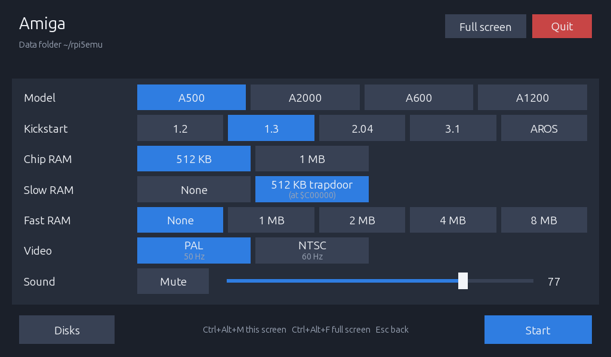
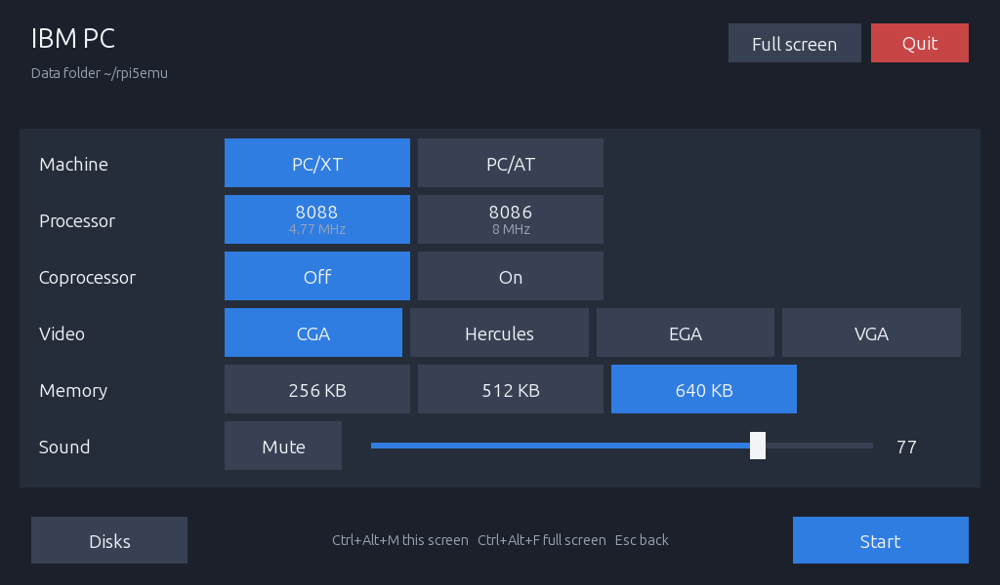

<h1 align="center">sdlemu</h1>

<p align="center">
  <b>The shared SDL 3 runtime for the desktop emulators on 64-bit Linux and Apple Silicon macOS.</b><br>
  Used by <a href="https://github.com/rlucencic/sdlzx">sdlzx</a> (ZX Spectrum 128K, +2, +3), <a href="https://github.com/rlucencic/sdlcpc">sdlcpc</a> (Amstrad CPC), <a href="https://github.com/rlucencic/sdlcbm">sdlcbm</a> (Commodore 64, 128), <a href="https://github.com/rlucencic/sdlcoco">sdlcoco</a> (Tandy Color Computer 2, 3), <a href="https://github.com/rlucencic/sdlgs">sdlgs</a> (Apple IIGS), <a href="https://github.com/rlucencic/sdlmsx">sdlmsx</a> (MSX1, MSX2), <a href="https://github.com/rlucencic/sdlxl">sdlxl</a> (Atari 800XL, 130XE), <a href="https://github.com/rlucencic/sdlste">sdlste</a> (Atari STE), <a href="https://github.com/rlucencic/sdlpc">sdlpc</a> (IBM PC/XT and PC/AT), <a href="https://github.com/rlucencic/sdlmac">sdlmac</a> (Macintosh Plus, SE, Classic), <a href="https://github.com/rlucencic/sdlmac2">sdlmac2</a> (Macintosh LC and II), <a href="https://github.com/rlucencic/sdlmac3">sdlmac3</a> (Macintosh LC II and LC III), <a href="https://github.com/rlucencic/sdlarc">sdlarc</a> (Acorn Archimedes) and <a href="https://github.com/rlucencic/sdlami">sdlami</a> (Amiga 500, 2000, 600, 1200).
</p>

<p align="center">
  
  
  
  
  
  
</p>

<p align="center">
  
  
  <br>
  <sub>The setup screen in the Amiga's and the PC's windows: each machine's own choices,
  the sound, the drives.</sub>
</p>

sdlemu provides the desktop runtime for Linux arm64 (including Raspberry Pi 5),
Linux amd64 and macOS arm64. SDL 3 provides a native window,
sound, the host's keyboard and mouse, a setup screen in the window, a web page for disk
images, a console of line commands, the settings and a data folder for ROMs and disk
images (`~/sdlemu`: a folder for each machine, its images in it and its ROMs in its
`roms/`, e.g. `zx/roms`; the three Macs share `mac/`).

The machines aren't written again: they are the
[esp32emu](https://github.com/rlucencic/esp32emu) family's. Each sdl project compiles
its esp32 sibling's platform-independent machine core and esp32emu's CPU cores (68000 to
68030, Z80, 6502, 65C816, 6809, ARM2, x86) and plugs them into this runtime through the
same `emu_machine_t` interface they have on the ESP32 boards: one implementation of each
machine for the boards and desktop hosts.

## What it gives a machine

| Part | What |
|---|---|
| `src/emu.c` | The window and the picture (the main thread: scaled to the window in the machine's shape, sharp or smooth, drawn again only when it changed), the emulation thread (one frame at a time, paced by the clock; the sound into an SDL stream, its rate nudged to follow the sound card), holds between frames (`emu_paused()`), keyboard (HID usages, host keys by position) and mouse (captured with a click), the window's own keys, the status |
| `src/ui.c` | The setup screen, as the boards' but drawn with SDL: the machine's choice rows, the sound, the drives and their images, Start / Back / Restart, Reset; shown at start and with Ctrl+Alt+M; SDL3_ttf text (or SDL's own 8 x 8 font) |
| `src/web.c` | The boards' web page (esp32emu's `web/index.html`, built in) and its API: the status, drives, disk images (upload, download, delete, insert, new blank ones), a machine's own script (converters, packers) |
| `src/console.c` | Line commands on the terminal and on `127.0.0.1:6400`: the state, keys and typing (the machine's), drives, screenshots, choices, the setup screen |
| `src/disks.c`, `src/settings.c` | The data folder's images for the drives, remembered across starts; the settings file, sections as the boards' NVS namespaces (`emu/nvs.h` gives the boards' settings code the NVS calls) |
| esp32emu's `emudbg` | The debugger of the family (`--debug <port>`, the VS Code extension [esp32emu-vscode](https://github.com/rlucencic/esp32emu-vscode)) |
| `tools/` | `pi.sh` (sync to the Pi, build, run there with the window here, or headless), `console.sh`, `capture.sh`; `pi.ps1` and `console.ps1`, the same from Windows; `data_folders.sh` (an old data folder's shared `roms/` and disk folders into the machines' own); and the porting scripts that carry a machine's glue over from its esp32 sibling |

## Building

Install a C compiler, CMake, Ninja, pkg-config, SDL 3.2 or newer and libpng.
SDL3_ttf is optional. Some machines also use zlib.

On Debian or Ubuntu releases with SDL 3 packages:

```sh
sudo apt install build-essential cmake ninja-build pkg-config \
                 libsdl3-dev libsdl3-ttf-dev libpng-dev zlib1g-dev
```

On Apple Silicon macOS with Xcode Command Line Tools and Homebrew:

```sh
brew install cmake ninja pkgconf sdl3 libpng zlib
```

Build a machine with its siblings cloned side by side:

```sh
git clone https://github.com/rlucencic/esp32emu
git clone https://github.com/rlucencic/sdlemu
git clone https://github.com/rlucencic/esp32zx
git clone https://github.com/rlucencic/sdlzx
cd sdlzx && cmake -S . -B build -G Ninja && cmake --build build
build/sdlzx --help
```

## Using it

A machine project's `CMakeLists.txt`:

```cmake
add_subdirectory(${CMAKE_CURRENT_LIST_DIR}/../sdlemu sdlemu)
file(GLOB CORE ${CMAKE_CURRENT_LIST_DIR}/../esp32zx/components/zx/*.c)
add_executable(sdlzx src/main.c src/settings.c src/rom_store.c ${CORE})
target_compile_definitions(sdlzx PRIVATE CONFIG_Z80_CONTENTION=1)   # the core's options
sdlemu_add_cores(sdlzx z80 upd765 diskspace)                       # esp32emu's components
sdlemu_embed(sdlzx ${CMAKE_CURRENT_LIST_DIR}/web/script.js zx_js)  # optional: the web page's script
target_link_libraries(sdlzx PRIVATE sdlemu)
```

The machine fills in an `emu_machine_t` (`include/emu/emu.h`), the boards' interface, and
hands it over:

```c
static const emu_machine_t machine = {
    .name = "ZX Spectrum", .short_name = "Spectrum",
    .view_width = 704, .scale = EMU_SCALE_NEAREST,    /* its shape: the width at 600 lines */
    .reserve_memory = reserve_memory, .start = start, .reset = zx_reset, .run_frame = zx_run_frame,
    .screen_mode = screen_mode, .screen_signature = zx_screen_signature,
    .render_line = zx_render_line_rgb565,
    .audio_hz = ZX_AUDIO_HZ, .audio_render = zx_audio_render, ...
    .hid_key = hid_key,                               /* keys by HID usage */
    .choices = choices, .choice_count = 2,            /* the setup screen's rows */
    .disks = &disks,                                  /* drives, image kinds, blank sizes */
    .status = status, .console_command = console_command,
    .shutdown = shutdown,                             /* flush disk images on shutdown */
};

int main(int argc, char **argv) { return emu_main(&machine, argc, argv); }
```

Every machine takes the same options (`--help`): `-S` to start at once (else the setup
screen first), `--choice LABEL=NAME` for the setup screen's rows, `-f` full screen,
`-s N` the window's size, `--data DIR` (default `~/sdlemu`), `--console PORT`, `--web
PORT` (default 8080; `0` turns it off: the page is open to your network, as the boards'
is), `--debug PORT`, `--no-sound`, and images to insert.

The window's own keys (the machine gets all the others): Ctrl+Alt+M the setup screen,
Ctrl+Alt+F full screen, Ctrl+Alt+G frees the mouse, Ctrl+Alt+W warp speed, Ctrl+Alt+S a
screenshot, Ctrl+Alt+R reset, Ctrl+Alt+Q quit. Images can be dropped on the window.

The window can be shown on another computer's X display with `ssh -C -Y <the Pi>`: good
for the setup screen and still pictures, but every changed picture crosses the network
(8 to 15 a second on a home network): for games, a monitor on the Pi.

Existing Pi installations can keep their data and settings. The runtime accepts
`RPI5EMU_HOME` as a fallback for `SDLEMU_HOME`. When no explicit path is set,
it uses an existing `~/rpi5emu` directory if `~/sdlemu` is absent. It also
uses an existing `rpi5emu/settings.ini` under the config directory if
`sdlemu/settings.ini` is absent.

## Limitations

- The machine READMEs describe Pi compatibility checks. The Linux amd64 and macOS
  arm64 builds were checked with console and screenshot smoke tests on ZX Spectrum
  and IBM PC. Interactive macOS input and audio still need testing.
- No game controllers yet: the joysticks are the keypad and cursor keys, as with the
  boards' Bluetooth keyboards.

## Licence

[MIT](LICENSE). SDL (zlib licence) and SDL_ttf are the system's.
